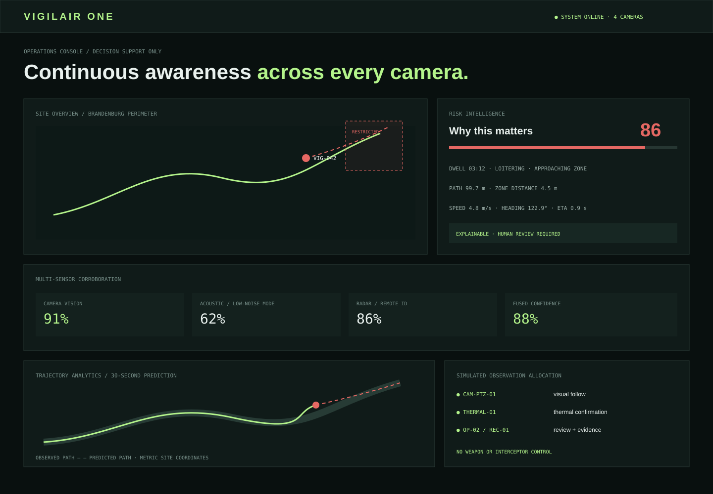

# VIGILAIR ONE

Low-cost aerial awareness and operator decision support for critical-infrastructure sites.

## Run the demo

Frontend:

```powershell
npm install
npm run dev
```

Backend on Windows:

```powershell
Copy-Item .env.example .env
python -m venv .venv
.\.venv\Scripts\Activate.ps1
pip install -r requirements.txt
uvicorn backend.main:app --reload --host 0.0.0.0 --port 8000
```

Or use `scripts/run_demo.ps1`.

## Replay the dummy scenario

```powershell
curl -X POST http://localhost:8000/api/replay/reset
curl http://localhost:8000/api/tracks
curl http://localhost:8000/api/incidents/VIG-042
```

The scenario contains a likely drone crossing cameras and a bird false alarm. The risk score is deliberately transparent and independent of any language model.

## Repository map

- `src/`: React operator console.
- `backend/`: FastAPI service, schemas, replay, tracker, and risk engine.
- `data/`: camera registry and synthetic observations.
- `docs/SYSTEM_DESIGN.md`: architecture and scaling plan.
- `docs/DATA_CONTRACT.md`: expected camera, detection, tracking, and sensor payloads.
- `docs/MODELS_AND_ENV.md`: model choices, Featherless usage, and environment setup.
- `docs/screenshots/dashboard.svg`: dashboard preview asset.
- `testsampledata/`: synthetic multimodal fixtures for video, detections, tracks, radar, thermal, Remote ID, acoustic, weather, health, and incidents.

## Dashboard preview



## Control boundary

The app includes observation and coordination controls only: camera focus, evidence replay, operator summaries, track annotation, and recommendation logging. It intentionally cannot pilot or redirect a drone, control a weapon, operate a jammer, trigger an interceptor, or command any physical response system.
