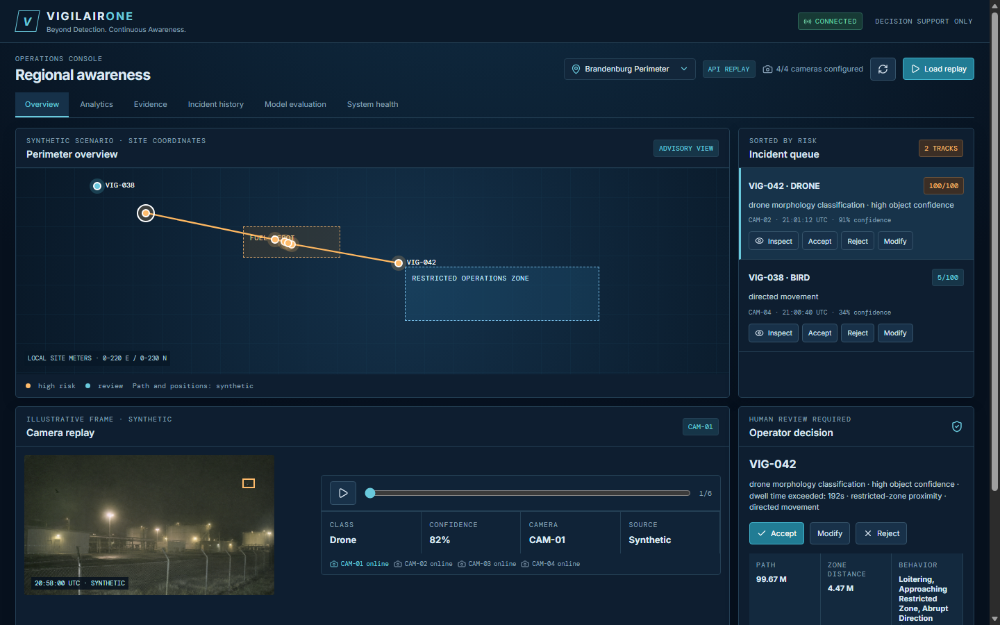
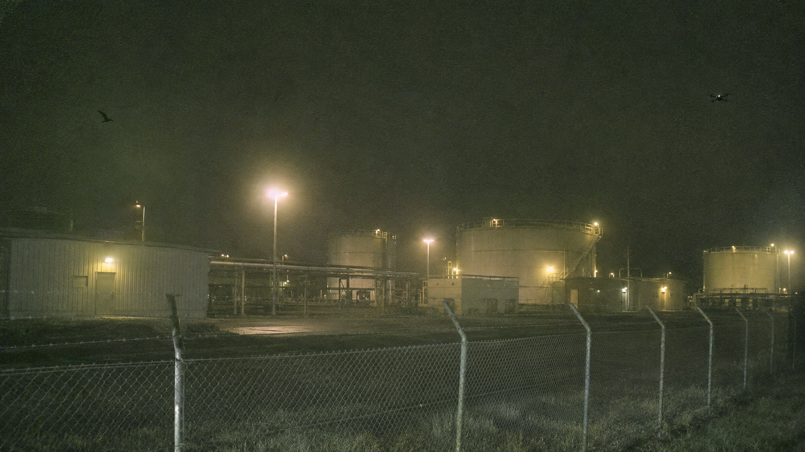

# VIGILAIR ONE

Low-cost aerial awareness and operator decision support for critical-infrastructure sites.

The default **Research lab** offers an offline hardware-free demonstration with 28 fictional MapLibre zones, a synthetic hybrid event replay, local model-package readiness, virtual sensors, media review, human annotations, WAV plots, and persistent dark/light mode. See [Research demonstration](docs/RESEARCH_DEMO.md) for data provenance, model package requirements, endpoints, testing and limits. **Overview** retains the existing operator console and incident workflows.

Research dashboard captures: [1440×900 dark 2D](docs/screenshots/research-1440.png) and [1920×1080 light 3D](docs/screenshots/research-1920-light.png). Capture the running API and Vite app again with `node scripts/capture_research.mjs`.

## Run the demo

Frontend:

```powershell
npm install
npm run dev
```

Backend on Windows:

```powershell
Copy-Item .env.example .env
python -m venv .venv
.\.venv\Scripts\Activate.ps1
pip install -r requirements.txt
uvicorn backend.main:app --reload --host 0.0.0.0 --port 8000
```

Or use `scripts/run_demo.ps1`.

The startup script binds to loopback. Pass `-InstallDependencies` for first-time setup if the active Python environment is missing dependencies.

### Offline detector replay and evaluation

From the repository root, put approved footage and trusted weights in an ignored local directory such as `artifacts/`. Use the checkpoint digest from a trusted release or internal model registry. A matching checksum cannot establish that an unknown PyTorch checkpoint is safe.

```powershell
python -m scripts.replay_tools yolo artifacts/clip.mp4 artifacts/model.pt artifacts/predictions.json --weights-sha256 TRUSTED_SHA256 --require-class drone --require-class bird
python -m scripts.replay_tools validate artifacts/predictions.json --video artifacts/clip.mp4
python -m scripts.replay_tools evaluate artifacts/predictions.json artifacts/annotations.json
```

The runner uses frame indexes divided by FPS, so use constant frame rate footage. The evaluator expects version 1 bundles with the same video digest, dimensions, FPS and frame indexes. Reference annotations use `source: manual` and pixel boxes with `label` and `xyxy`; include an empty boxes array for labeled frames without objects. Results use one-to-one class-aware matching at IoU 0.5. Reported prediction latency excludes video decoding and includes the initial inference call.

Experimental SNN outputs can use the same evaluator with `source: snn`, `weights_sha256`, and `input_kind` set to `recorded_events` or `simulated_events`. An SNN runtime and event data are needed to generate predictions.

### Hybrid YOLO and SNN activity replay

Open **Model evaluation** to run the bundled hybrid experiment, or run `python -m backend.hybrid_replay` from the repository root. The spiking branch runs a CPU leaky integrate-and-fire simulation on paired temporal windows. The console reports synthetic vision labels, simulated event counts, actual simulated spikes, and measured CPU compute time for the spiking step.

Use `python -m backend.hybrid_replay path/to/paired-windows.json` with data shaped like `testsampledata/hybrid_replay.json`. Pair event windows and vision detections from the same time interval and image region before exporting them. Supply the YOLO class and confidence for that region and ordered relative event timestamps in milliseconds. Mark the input provenance explicitly. The evaluator accepts recorded event windows and YOLO prediction values, but does not ingest raw event-camera files or automatically align camera streams. Optional activity labels allow an activity agreement score. This experiment does not measure drone classification accuracy, sensor power, or end-to-end latency.

### Challenge 05 model integration

The local Challenge 05 adapter audits the organizer's train, validation and held-out test manifests and accepts a trusted acoustic `.onnx` model or the starter kit's plain `.pt` state dict. It provides CLI batch submissions and bounded PNG inference endpoints. RF-DETR Nano is available as an optional **full ONNX** still-frame adapter with an explicit class map; the existing YOLO `.pt` replay remains available. See [Challenge 05 integration](docs/CHALLENGE05_INTEGRATION.md) for setup, model transfer, commands and input contracts. No trained Challenge 05 weights are included in the repository.

Open **Video replay** in the console and select the original video and the version 1 replay JSON. Files are opened locally in the browser. The video must match the digest and metadata in the bundle. Boxes can include `track_id`, `camera_id`, and `observation_timestamp` to link to an existing observation in the selected site. Select a linked frame as evidence to include its reference in the incident JSON export. Raw video and the browser's evidence selection are not stored by the API.

Operator decisions are stored in local SQLite at `DECISION_DB_PATH`. Reloading the same synthetic incident retrieves its history after restart. Track observations are still stored in memory.

To score the forecast against a held-out observation in the same site and track, run `python -m scripts.evaluate_forecast data/scenario.json --horizon 10 --tolerance 1`. Review the sample count and input provenance before interpreting error. Sparse replay tracks may yield no comparable samples.

Run the browser workflow test using `npm run test:browser`. Set `PLAYWRIGHT_CHANNEL=msedge` in the environment to use installed Edge, or install Playwright Chromium with `npx playwright install chromium`.

Run the complete local verification suite with:

```powershell
.\scripts\verify_project.ps1
```

## Replay the dummy scenario

```powershell
curl -X POST http://localhost:8000/api/replay/reset
curl http://localhost:8000/api/tracks
curl http://localhost:8000/api/incidents/VIG-042
curl http://localhost:8000/api/tracks/VIG-042/analytics
curl http://localhost:8000/api/tracks/VIG-042/resource-allocation
curl http://localhost:8000/api/sites
curl http://localhost:8000/api/global-tracks
curl -X POST http://localhost:8000/api/calibration/pixel-to-site -H "Content-Type: application/json" -d '{"camera_id":"CAM-01","x":100,"y":900}'
```

The console refreshes observations and regional history every five seconds. The site map draws observed positions and a dashed forecast for the newest metric observation when there are at least two observations at that site. The forecast projects the current speed and heading up to 30 seconds. For nonsynthetic observations, it is hidden when the newest position is more than 15 seconds old. Regional history displays reported associations, including candidates and rejections, without drawing an observed path through coverage gaps.

The scenario contains a likely drone crossing cameras and a bird false alarm. The risk score is deliberately transparent and independent of any language model.

## Site weather and local clock

The console displays the selected site's local date and time and regional weather estimates from [Open-Meteo](https://open-meteo.com/). Set a site's latitude, longitude, and IANA timezone in `data/sites.json`. This sends the selected site's coordinates to Open-Meteo. The non-commercial hosted API requires no key. Set `WEATHER_ENABLED=false` in the backend `.env` to disable external requests and keep the clock visible.

The API caches each site for 15 minutes and clearly labels stale data during provider outages. Provider validity time and retrieval time are displayed separately. Weather estimates are contextual and separate from on-site sensor measurements, incident timestamps, and the risk engine.

## Repository map

- `src/`: React operator console.
- `backend/`: FastAPI service, schemas, replay, tracker, and risk engine.
- `data/`: camera registry and synthetic observations.
- `docs/SYSTEM_DESIGN.md`: architecture and scaling plan.
- `docs/DATA_CONTRACT.md`: expected camera, detection, tracking, and sensor payloads.
- `docs/MODELS_AND_ENV.md`: model choices, Featherless usage, and environment setup.
- `docs/ALGORITHMS.md`: detector, tracker, geometry, fusion, XGBoost, and evaluation choices.
- `docs/HARDWARE_PLAN.md`: fixed-site low-cost hardware and calibration requirements.
- `docs/DATASETS.md`: candidate public/research datasets and leakage-safe split policy.
- `docs/screenshots/console-1440.png` and `console-1920.png`: browser captures of the operations console.
- `testsampledata/`: synthetic multimodal fixtures for video, detections, tracks, radar, thermal, Remote ID, acoustic, weather, health, and incidents.

## Dashboard preview



[View the 1920 × 1080 screenshot](docs/screenshots/console-1920.png)

The live-demo camera panel uses the project-owned synthetic frame at `public/demo/night-camera-synthetic.png` and overlays the drone and bird detections in the browser.




## Control boundary

The app includes observation and coordination controls only: camera focus, evidence replay, operator summaries, track annotation, and recommendation logging. It intentionally cannot pilot or redirect a drone, control a weapon, operate a jammer, trigger an interceptor, or command any physical response system.
